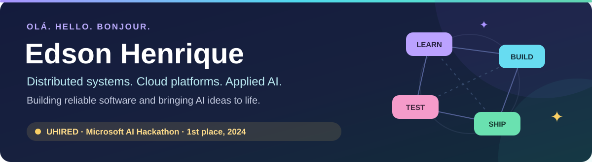
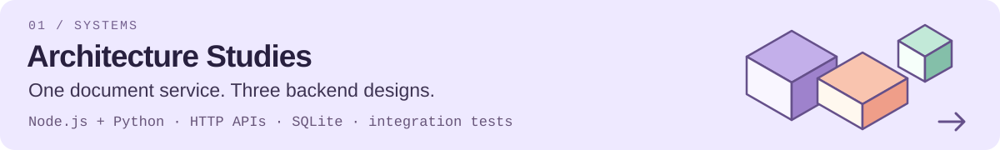
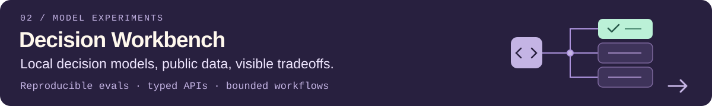
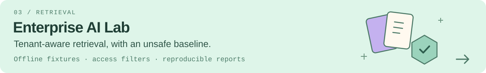

<picture>
  <source media="(max-width: 600px)" srcset="assets/header-mobile.svg">
  
</picture>

Hey, I'm Edson. 👋

I'm a software engineer in Montréal, with a background in backend systems,
cloud infrastructure and performance at **CapIntel, SSENSE and XP Inc.**
Here you'll find my open-source work on service architecture, retrieval and
local decision models.

### 🧪 Open work

<a href="https://github.com/edsonsims/architecture-studies">
  <picture>
    <source media="(max-width: 600px)" srcset="assets/architecture-mobile.svg">
    
  </picture>
</a>

<a href="https://github.com/edsonsims/decision-workbench">
  <picture>
    <source media="(max-width: 600px)" srcset="assets/decision-mobile.svg">
    
  </picture>
</a>

<a href="https://github.com/edsonsims/enterprise-ai-lab">
  <picture>
    <source media="(max-width: 600px)" srcset="assets/retrieval-mobile.svg">
    
  </picture>
</a>

### Merged upstream contributions

- **[pyproject-api](https://github.com/tox-dev/pyproject-api/pull/323)** — Prevent source-tree deletion from unsafe metadata output paths, with regression tests for ancestor paths and symlink aliases.
- **[pytest-env](https://github.com/pytest-dev/pytest-env/pull/273)** — Honor explicitly empty environment-file lists instead of loading fallback files, with subprocess regression tests.
- **[filelock](https://github.com/tox-dev/filelock/pull/859)** — Handle NetBSD symlink-refusal errors as lost ownership in soft reader/writer locks.
- **[pyfakefs](https://github.com/pytest-dev/pyfakefs/pull/1356)** — Measure setup benchmarks with CPU time after warmup, retaining coarse regression limits and testing the measurement itself.
- **[Meriyah](https://github.com/meriyah/meriyah/pull/672)** — Correct parsing of default-exported arrows using `async` as a parameter, with scope and syntax regression tests.
- **[Pydash](https://github.com/dgilland/pydash/pull/381)** — Process many input arrays in XOR helpers without hitting Python's recursion limit, preserving iteratee and comparator behavior.

### 🎙️ The story behind UHIRED

I knew my experience. Explaining it in an interview was harder.
That's why I built **UHIRED**: practice answering questions aloud around a job
description, then get feedback on each answer.

It won **1st place, Phase 2 — Learn and Integrate**, in the **Microsoft Developers
AI Learning Hackathon (2024)**.

[The project & demo](https://devpost.com/software/aitism) ·
[Microsoft's announcement](https://devblogs.microsoft.com/cosmosdb/meet-the-winners-microsoft-developers-azure-ai-azure-cosmos-db-learning-hackathon/)

### Elsewhere

[**LinkedIn ↗**](https://www.linkedin.com/in/henriquelops/) ·
[Devpost ↗](https://devpost.com/edsonsims)

> The concrete should serve the abstract. The temporal to the eternal.
